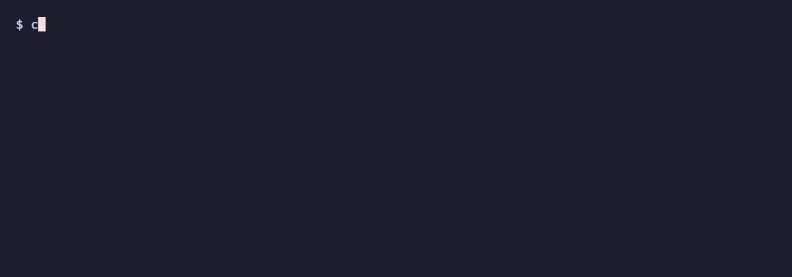

<p align="center">
  
</p>

<p align="center">
  <a href="https://slop-chop.com"></a>
  <a href="https://github.com/dcadolph/slop-chop/releases/latest"></a>
  <a href="https://github.com/dcadolph/slop-chop/actions/workflows/ci.yml"></a>
  <a href="https://github.com/dcadolph/slop-chop/actions/workflows/ci.yml"></a>
  <a href="https://pkg.go.dev/github.com/dcadolph/slop-chop/sanitize"></a>
</p>

# slop-chop

AI writing leaves fingerprints.

<p align="center">
  
</p>

Chop the slop. Paste in text and get back something that reads like a person wrote it.

Try it without installing anything: [slop-chop.com](https://slop-chop.com/) runs the same
engine in your browser.

AI writing has patterns. It loves em-dashes, drops a semicolon into every other sentence,
reaches for words like `comprehensive` and `leverage`, and clears its throat with
openers like "In summary" or "Giving it to you honestly."

slop-chop removes those patterns in a single pass. You can also hand it your own list of
things to cut, so the result reads like you instead of a chatbot.

## Why

Cleaning this up by hand is tedious. Asking a model to "stop using em-dashes" works for
about three sentences before it forgets. slop-chop applies the same cleanup rules every
time.

## How it works

There are two passes, and you can run either one on its own.

The first is a rules pass. It is fast and deterministic. It swaps characters, drops words
you have flagged, rewrites stock phrases and words, runs your own patterns, fixes spelling
to one dialect, and tidies the punctuation, with no model, no cost, and the same output on
every run. It knows markdown, so fenced code blocks and inline backtick spans come through
untouched.

The second is an optional rewrite pass that hands the text to a model for the things
rules cannot manage, like reworking a sentence so it no longer needs a semicolon, or
nudging the writing toward a voice you picked.

## Install

Homebrew:

```sh
brew install dcadolph/tap/slop-chop
```

With Go:

```sh
go install github.com/dcadolph/slop-chop@latest
```

Or clone and use the Makefile:

```sh
git clone git@github.com:dcadolph/slop-chop.git
cd slop-chop
make install     # build and install into $(go env GOPATH)/bin, version stamped
make uninstall   # remove it again
```

Run `make` with no target for the full list (`build`, `test`, `cover`, `lint`, `fmt`, `tidy`, `clean`).

## Does it work?

Three measurements, all reproducible from this repository. [docs/BENCHMARK.md](docs/BENCHMARK.md)
has the method and the caveats.

It stays quiet on human writing. Scored against 886 open-source READMEs across seven
language ecosystems, most from projects with no push since 2021, seven reach the line where
text stops reading clean. That is 0.8 percent, and it is the line the GitHub Action fails on
by default. `slop-chop check` is stricter. It fails a file on any single tell that carries
weight, and 41.5 percent of the same READMEs use at least one.

Word lists lose to a thesaurus. `slop-chop attack` swaps text to dodge the rules without
improving it, and 33 of 74 word tells slip past. Only 1 of 90 structural tells does, which
is why a sentence shape counts double in the score. That number bounds the attacker rather
than the rules: a swap never rebuilds a sentence, so it was never going to reach a shape.
How those rules fare against a model told to rewrite is unmeasured.

The test that would settle it has not been run. Nobody has yet checked whether the score
ranks text the way human readers do. The rating protocol and the harness are in
[evaldata/](evaldata/). Until that runs, the claim stays narrow: same input, same output,
and the patterns the rules know get caught every time.

## Usage

```sh
# Print the cleaned text to stdout. Your file is not changed.
slop-chop fix notes.md

# Clean the file in place, like gofmt -w.
slop-chop fix -w notes.md

# Pipe text through it
echo "In summary, a robust—and seamless—result." | slop-chop fix

# Flag slop without changing anything (exits non-zero if a finding carries score weight)
slop-chop check notes.md

# Check or fix several files at once
slop-chop check docs/intro.md docs/guide.md README.md
slop-chop fix -w docs/intro.md docs/guide.md

# Enforce a spelling variant: flag or fix the other dialect
slop-chop check --dialect american notes.md
slop-chop fix --dialect british notes.md

# Overlay a built-in pack, like corporate phrasing to plain English
slop-chop fix --preset plain notes.md

# Use your own profile
slop-chop fix --profile myprofile.json notes.md

# Get findings as JSON for other tools to read
slop-chop check --json notes.md
slop-chop check --json --pretty notes.md

# Deeper clean: rules first, then a model rewrite (needs ANTHROPIC_API_KEY)
slop-chop fix --rewrite notes.md
slop-chop fix --rewrite --verify notes.md
```

`check --json` prints a `{"findings": [...]}` object to stdout. `fix --json` returns
`{"cleaned": "...", "findings": [...], "remaining": [...], "score": {...}, "scoreAfter": {...}}`.
Each finding carries the rule, the matched text, the suggested replacement, and a line and
column. A finding with a replacement was rewritten, and one without was only flagged.
`remaining` is what `check` reports on the cleaned text, the tells no rule can rewrite for
you. Without `--json`, `fix` prints one line on stderr saying what it rewrote, what it left
for you, and how the score moved.

## Modes

- `check` flags what it finds and exits non-zero when a finding carries score weight.
  Cleanups with no weight are listed without failing. Pass `--strict` to fail on any
  finding. Drop it in CI. Add `--why` and every finding carries a plain-words line saying
  what fired and what happens to it, the same explanations the web app shows on a tap.
- `fix` writes the cleaned text to stdout and leaves your file alone. Pass `-w` to change
  the file in place instead.
- `score` measures how densely the text carries the patterns your profile lists, 0 to 100.
It is a lint result, not a reading on who wrote the text, and it cannot be turned into one:
the same patterns appear in writing people produce on purpose. Under 25 reads clean, 25 to
54 is mixed, and 55 and up is dense with tells, the same bands the web app shows.
`score --by-paragraph` scores each paragraph on its own, which is how a document with two
generated paragraphs buried in a thousand human words shows where they are, and `--max`
then gates on the hottest paragraph instead of the diluted whole.

Source code gets its own treatment. On a `.go`, `.py`, `.ts`, or any other code file,
`check` and `score` read only the comments, plus the docstrings in a Python file, so a
buzzword in a comment is flagged at its real line and column while identifiers, strings, and
formatting alignment draw nothing.
`fix` refuses to rewrite code files outright, since prose cleanups break code. Pipe a
file through stdin to read it as plain text on purpose, or add `--as .go` to read stdin as
a source file of that type and scan only its comments, which is how an editor checks an
unsaved buffer. Comments nested inside a function are scanned like any other. Data files
with no comments, like `.json` and `.csv`, are skipped with a note.

## Score

`score` gives a single number from 0 to 100 for how densely the text carries the patterns
the active profile lists. Change the profile and the same prose scores differently, which
is the clearest statement of what the number is: compliance with a named ruleset. A
structural tell counts double toward the density, because a stock sentence shape survives
a thesaurus where a listed word does not.

The engine ships with a labeled corpus of AI, human, and technical passages under
`sanitize/testdata/`, and `TestBenchmark` measures recall, precision, and the score margin
against it on every run, so a change that weakens detection fails the build instead of
going unnoticed. [docs/BENCHMARK.md](docs/BENCHMARK.md) shows the numbers, the corpus
composition, what fires on what, and the limits of what the score claims. The score is a
lint result, not an authorship verdict.

```sh
slop-chop score notes.md            # notes.md: 42 (mixed: 5 tells in 180 words)
slop-chop score --json notes.md     # {"value":42,"scoringVersion":2,"tells":7,...}
slop-chop score --max 20 notes.md   # exit non-zero when the score is above 20
```

`--max` turns it into a gate, so a document over the bar fails a build the same way `check`
does.

Every score names the scoring version that produced it. The version rises on any release
that can move the score of unchanged text, and [docs/SCORING.md](docs/SCORING.md) lists what
moved, so a gate set on one version keeps its meaning until the number changes. A test in
the repo fails when the benchmark corpus scores differently without a bump.

## Structural tells

Word swaps catch the vocabulary of AI writing. The rules pass also flags 61 structural
tells that a word list misses: the `it's not just X, it's Y` cadence and its contracted
`isn't a perk. It's an expectation` twin, the `let's dive in` opener, `here's the thing`
throat-clearing, the `The best part?` fragment reveal, `here are five ways` enumeration,
runs of bold-label bullets and numbered items, emoji-decorated headings, and the spaced
hyphen models reach for now that the em-dash is a known tell. It also catches the register
of a chat reply rather than a piece of writing: `let me break this down`, `you might be
wondering`, `here's where it gets interesting`, `happy coding!`, and the `say goodbye to
X` and `Enter Foo, the tool that` moves of generated marketing copy. These are flagged, not
rewritten, since the fix depends on the whole sentence and is left to the rewrite pass. Add
your own with the `flagPatterns` field in a profile.

Every tell that becomes famous gets trained out of the next model and the writing moves
somewhere else, so the default profile tracks what models write now rather than what they
wrote in 2023.

## Use it in CI

Add a workflow that fails a pull request when a file scores above 25 on the slop score. Every
finding is still listed in the run log, so the whitespace and punctuation tidy-ups show up
without failing the build:

```yaml
name: slop-chop
on: pull_request
jobs:
  slop:
    runs-on: ubuntu-latest
    steps:
      - uses: actions/checkout@v7
      - uses: dcadolph/slop-chop@v0.55.1
        with:
          files: docs/intro.md docs/guide.md
          # max: 25                   # optional, the score line
          # strict: "true"            # optional, fail on any single finding
          # scoring-version: "1"      # optional, fail when the engine scores differently
          # profile: myprofile.json   # optional
          # dialect: american         # optional
          # preset: plain             # optional
```

Set `max` to move the line, or `max: 100` to turn the score gate off. Set `strict: "true"` to
fail on any single finding, the way `slop-chop check --strict` does on the command line. The
default line sits where ordinary human writing almost never lands: 0.8 percent of the 886
READMEs in the [benchmark](docs/BENCHMARK.md) score 25 or more.

The action builds the engine from the tag you name, so the tag pins the engine and its
scoring version together. A newer tag can score the same file differently when its scoring
version is higher. Set `scoring-version` to the version your gate was tuned against and the
job fails, with a pointer to [docs/SCORING.md](docs/SCORING.md), the day a tag bump changes
it, instead of quietly moving your gate.

A finding that is right for your repo has two exits. Silence one line with a directive, in
Markdown or in a code comment, or stop flagging a word everywhere with the `allow` list in
a `.slop-chop.json` at the repo root, which the action picks up on its own:

```md
<!-- slop-chop-ignore-next-line -->
We leverage the platform on purpose here.
```

```go
// slop-chop-ignore-next-line
// A robust fallback for the legacy path.
```

```json
{ "allow": ["leverage", "robust"] }
```

`slop-chop-ignore` alone silences the line it sits on. [docs/PROFILE.md](docs/PROFILE.md)
has the rest.

Or have it fix the files and push the cleanup back to the pull request branch:

```yaml
name: slop-chop
on: pull_request
jobs:
  slop:
    runs-on: ubuntu-latest
    permissions:
      contents: write
    steps:
      - uses: actions/checkout@v7
        with:
          ref: ${{ github.head_ref }}
      - uses: dcadolph/slop-chop@v0.55.1
        with:
          files: docs/intro.md docs/guide.md
          mode: fix
          commit: "true"
          # message: Chop the slop   # optional commit message
```

The fix-and-commit workflow pushes back to the pull request branch, so it works for pull
requests from a branch in the same repository. A pull request from a fork gets a read-only
token, so the push fails with a 403 no matter the `permissions` block. For fork pull requests
use the check workflow above: it needs no write access and still fails the run on slop. To
auto-fix your own branches, run the same fix-and-commit job on a `push` trigger instead.

To see findings as code scanning alerts, on the pull request diff and in the Security tab,
set `sarif` to a path and upload the log it writes:

```yaml
name: slop-chop
on: pull_request
jobs:
  slop:
    runs-on: ubuntu-latest
    permissions:
      contents: read
      security-events: write
    steps:
      - uses: actions/checkout@v7
      - uses: dcadolph/slop-chop@v0.55.1
        with:
          files: docs/intro.md docs/guide.md
          sarif: slop-chop.sarif
      - uses: github/codeql-action/upload-sarif@v4
        if: ${{ !cancelled() }}
        with:
          sarif_file: slop-chop.sarif
          category: slop-chop
```

The upload runs even when the score gate fails the job, so the alerts land on the pull request
that caused them. Findings that count toward the score are warnings and the rest are
notes. None are errors, so by default the alerts never fail the pull request check and the
score stays the gate. Code scanning uploads are free on public repositories, and private ones
need GitHub Code Security. A pull request from a fork gets a read-only token, so the upload
fails there. On the command line, `slop-chop check --sarif` writes the same log to stdout for
any number of files.

To hold the pull request title and body to the same line, set `pull-request: "true"`. Run it
as its own workflow with the `edited` type, so a title or description edit checks again
without rerunning the rest of your CI:

```yaml
name: slop-chop pull request
on:
  pull_request:
    types: [opened, edited, synchronize, reopened]
jobs:
  text:
    if: github.event.pull_request.user.type != 'Bot'
    runs-on: ubuntu-latest
    steps:
      - uses: actions/checkout@v7
      - uses: dcadolph/slop-chop@v0.55.1
        with:
          pull-request: "true"
```

The title and body are checked as one text, the title on line 1 and the body from line 3,
under the same `max` and `strict` as files. The text comes from the event, so the check
needs no token and works on pull requests from forks. A rerun reads the text as it was when
the run started, so after an edit the `edited` run is the one that counts. The `if` skips
Dependabot and Renovate, whose bodies carry upstream release notes, and the checkout lets
the repo's `.slop-chop.json` apply. Add `files` to check files in the same step, or set
`pull-request-title` and `pull-request-body` to check other text from a workflow on another
trigger. Code blocks and HTML comments are skipped, so a pull request template does not
count against the author. To silence one line, the author puts a comment GitHub does not
render above it: `<!-- slop-chop-ignore-next-line -->`.

The Action installs Go with `actions/setup-go@v7`, which runs on Node 24. A self-hosted runner
needs version 2.327.1 or newer. The setup step also sets `GOTOOLCHAIN=local` for the rest of
the job, so later `go` commands in that job use the installed Go instead of downloading one.

## Use it as a Claude Code plugin


The loop above is the point: the agent drafts, the engine judges deterministically, the
findings go back, and the rewrite is verified rather than trusted. slop-chop ships a
Claude Code plugin, so the assistant can run the tool for you. The repo is
its own marketplace. Add the marketplace, then install the plugin from it:

```
/plugin marketplace add dcadolph/slop-chop
/plugin install slop-chop@slop-chop
```

The `slop-chop@slop-chop` name is `plugin@marketplace`: the plugin named slop-chop, from the
marketplace named slop-chop.

The plugin drives the `slop-chop` binary rather than replacing it, so install the binary and
put it on your `PATH` first:

```sh
go install github.com/dcadolph/slop-chop@latest   # lands in $(go env GOPATH)/bin
slop-chop --version                                # confirm it is on PATH
```

The plugin then gives Claude two ways to reach the tool:

| Way            | What it is                                        | You do                                  |
| -------------- | ------------------------------------------------- | --------------------------------------- |
| `slop-chop` skill  | Claude picks it up on its own for a draft.    | Hand it text and ask for a clean.       |
| `/slop-chop` command | A command you invoke on a file or text.     | Type `/slop-chop notes.md`.             |

```
# Let the skill decide
Clean the slop out of this before I send it: <paste your text>

# Or call the command
/slop-chop notes.md
```

The rules pass is free. The rewrite pass needs a key and stays off unless you ask for it, so
say when you want the deeper clean, and name a backend if you want a local, keyless one:

```
Rewrite this to sound human, and use my local Ollama so it costs nothing.
```

[docs/PLUGIN.md](docs/PLUGIN.md) is the full plugin guide, including troubleshooting.

## Profiles and presets

A profile is a JSON file that lists what to cut and what to put in its place: characters,
phrases, words, regular expressions, a blacklist, and a few switches. Point the tool at one
with `--profile`, or drop a `.slop-chop.json` in the repo and it gets picked up on its
own from any directory under it. With neither, a built-in default runs.

Presets are curated packs you overlay with `--preset`. The built-in packs are `cleaver`,
`plain`, `corporate`, `academic`, `marketing`, `no-dashes`, `typography`, and `procedure`. `cleaver`
is the strongest cut: the default profile only flags buzzwords like `leverage` and
`robust`, and `cleaver` rewrites them to plain words, which is what the web app ships
switched on. `--preset plain`
turns corporate phrasing into plain English on top of whatever profile you already have,
and the others target the stock phrasing of their own worlds. The last two set dash
policy: `no-dashes` converts every dash posing as an em-dash to a comma, and `typography`
keeps typeset dashes, curly quotes, and ellipses for text where they are deliberate.
`procedure` is for instructions: it flags a sentence over 20 words in a list item and over
25 words elsewhere, and like a cleanup it carries no score weight, so add `--strict` to fail
on it. Overlay more than one with a comma: `--preset corporate,plain`.

[docs/PROFILE.md](docs/PROFILE.md) is the full reference: every field, the presets, the
spelling dialects, the allow list, and the inline ignore directives.

## Attack it

```sh
slop-chop attack draft.md
```

`attack` tries to beat your own rules. It rewrites text to dodge as many as it can while
leaving it no better written, then reports which tells held.

Buzzwords fall to a thesaurus: 33 of 74 word tells slip past. Only 1 of 90 structural
tells gets through, since a swap never rebuilds a sentence, so that row measures how far
the attacker reaches and not how durable a shape is. After the attack 67 of the 71
passages still carry a tell, and the mean score falls only from 83 to 78. A structural
tell counts double in the score for that reason.

Run it on your own profile to find which rules a thesaurus can defeat. `-w` saves the
evasive rewrites as a corpus. [docs/BENCHMARK.md](docs/BENCHMARK.md) has the full table
and the limits of what it proves.

## Your voice

`voice` is the personal layer: `keep` protects your words from every rule and preset,
`prefer` swaps a word for the one you would have used, and `avoid` flags your own
crutches. `slop-chop voice diff draft.md final.md` reads what you changed between a draft
and the version you shipped and proposes entries from your edits, which is the one voice
signal a model cannot feed back to you.

`slop-chop voice fingerprint posts/*.md` measures the part nobody quotes: sentence
rhythm, punctuation habits, and register, as numbers. `slop-chop voice drift draft.md`
then names every trait where a text stopped sounding like you, and `--bands 2` turns that
into a CI gate on a house voice. Drift is not slop, so nothing is rewritten and no score
moves. [docs/VOICE.md](docs/VOICE.md) has all of it.

## Rewrite pass (optional)

The rules pass is deterministic and free. For the work rules cannot do, like reworking a
sentence so it no longer needs a semicolon or bending the text toward your voice, add
`--rewrite`. It runs the rules first, then hands the result to a model. It needs
`ANTHROPIC_API_KEY` and costs money, so it stays off by default.

```sh
export ANTHROPIC_API_KEY=sk-...
slop-chop fix --rewrite notes.md
slop-chop fix --rewrite --verify notes.md
```

The reply is checked before you get it. The rules run over it again, its code blocks and
load-bearing tokens are compared against your input, and `--verify` adds a model pass that
flags a change in meaning. [ENGINE.md](ENGINE.md) covers the rewrite and its checks in
full.

### Backends

The rewrite pass defaults to Anthropic, but `--provider openai` points it at any
OpenAI-compatible Chat Completions API using `OPENAI_API_KEY`. With `--base-url` you can
aim that at a local server, so the rewrite runs on your own machine with no key and no cost.

```sh
# OpenAI
OPENAI_API_KEY=sk-... slop-chop fix --rewrite --provider openai --model gpt-4o notes.md

# Local Ollama, no key, no bill
slop-chop fix --rewrite --provider openai --base-url http://localhost:11434/v1 \
  --model llama3.1 notes.md
```

Using a different vendor to rewrite than the one that wrote the draft is a good idea, since
a model is bad at spotting its own tics.

## Use it as a Go library

The engine is a public package, so a Go program can chop text in process, with no binary to
shell out to and nothing sent anywhere. Add it:

```sh
go get github.com/dcadolph/slop-chop/sanitize
```

Build a sanitizer once from a profile and reuse it. `Fix` returns the cleaned text and the
tells it found, `Check` reports the tells without changing the text, and `Score` rates it from
0 to 100 by how densely the profile's patterns appear.

```go
package main

import (
	"fmt"

	"github.com/dcadolph/slop-chop/sanitize"
)

func main() {
	s, err := sanitize.New(sanitize.DefaultProfile())
	if err != nil {
		panic(err)
	}
	clean, findings := s.Fix("In summary, the plan—which shipped—works; the results speak for themselves.")
	fmt.Println(clean)              // The plan, which shipped, works. The results speak for themselves.
	fmt.Println(len(findings), "tells")
}
```

Overlay a built-in preset with `sanitize.ApplyPresets`, enforce a spelling dialect through the
profile's `Dialect` field, or fold in a personal `sanitize.Voice` with `profile.WithVoice`. The
optional model rewrite lives in `github.com/dcadolph/slop-chop/rewrite`. The full reference is
on [pkg.go.dev](https://pkg.go.dev/github.com/dcadolph/slop-chop/sanitize).

## Everywhere else

The same engine runs on many surfaces. All local and free unless noted.

| Where | Get it |
| --- | --- |
| Web app | [slop-chop.com](https://slop-chop.com), nothing to install |
| VS Code | search **slop-chop** on the [Visual Studio Marketplace](https://marketplace.visualstudio.com/items?itemName=dcadolph.slop-chop) |
| Cursor, VSCodium | search **slop-chop** on [Open VSX](https://open-vsx.org/extension/dcadolph/slop-chop) |
| JetBrains IDEs | the Marketplace plugin, or LSP4IJ with `slop-chop lsp`, see [docs/LSP.md](docs/LSP.md) |
| Neovim, Helix, any LSP editor | `slop-chop lsp`, see [docs/LSP.md](docs/LSP.md) |
| Obsidian | search **slop-chop** in Community plugins, source in [obsidian/](obsidian/) |
| Node | `npm install slop-chop-wasm` |
| Go programs | `import github.com/dcadolph/slop-chop/sanitize`, see [above](#use-it-as-a-go-library) |
| Claude Desktop, Cursor, any MCP client | `slop-chop mcp`, see [docs/MCP.md](docs/MCP.md) |
| CI, Raycast, macOS, pre-commit | the GitHub Action and [integrations/](integrations/) |

## Docs

| Doc                                | What is inside                                                                      |
|------------------------------------|-------------------------------------------------------------------------------------|
| [docs/PROFILE.md](docs/PROFILE.md) | Every profile field, the presets, dialects, the allow list, and ignores.            |
| [docs/SCORING.md](docs/SCORING.md) | The scoring version, what moved at each one, and how to pin a gate.                 |
| [docs/VOICE.md](docs/VOICE.md)     | Keep, prefer, and avoid, learning from your edits, and the voice fingerprint.&nbsp; |
| [docs/PLUGIN.md](docs/PLUGIN.md)   | The Claude Code plugin: install, the skill, the command, and backends.              |
| [ENGINE.md](ENGINE.md)             | How the engine works: rule kinds, the order they run in, and the rewrite.           |

## Status

Still early, but the core is in place. The rules pass is built and working. The rewrite
pass is built too and sits behind the `--rewrite` flag, because it needs an API key and
costs money, so the free, predictable rules pass stays the default. The live rewrite path
has a key-gated integration test, kept out of the default build so it never spends money by
accident. Run it against the real API with an API key:

```sh
ANTHROPIC_API_KEY=sk-... go test -tags=integration ./rewrite/ -run Live -v
```

## License

MIT. See [LICENSE](LICENSE).
